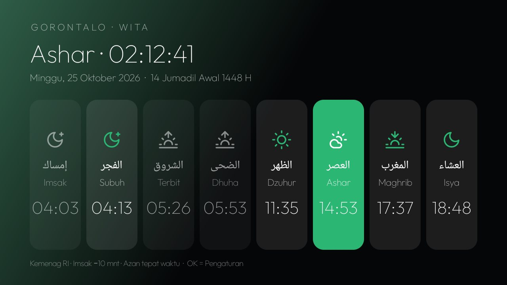
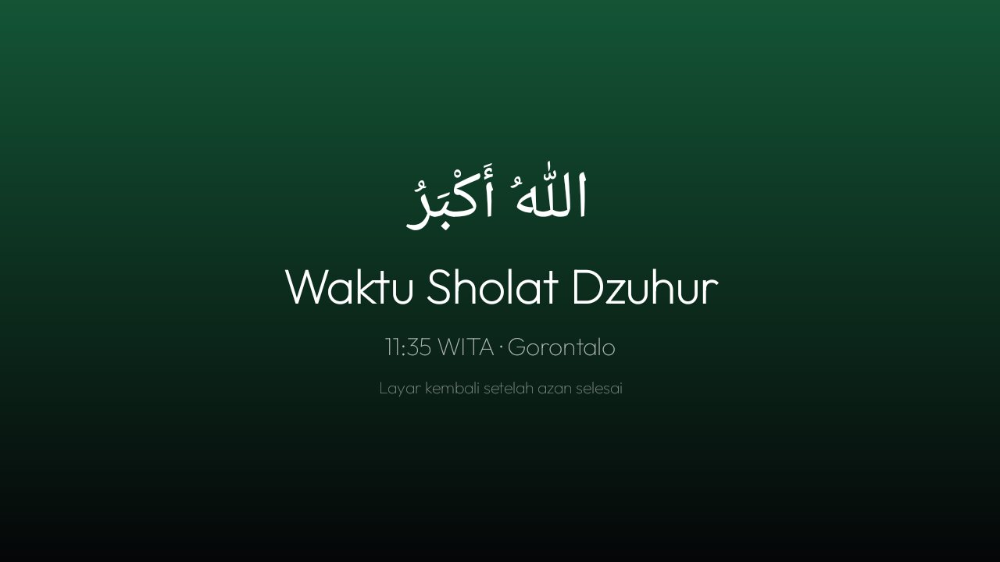
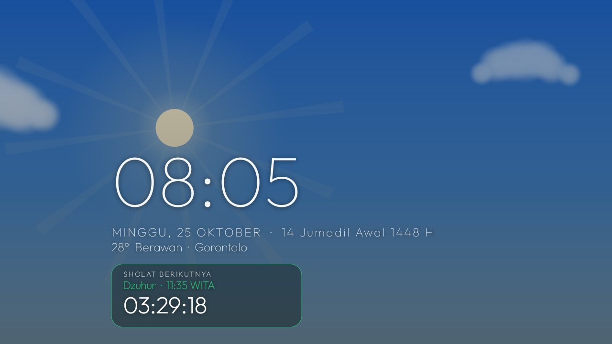
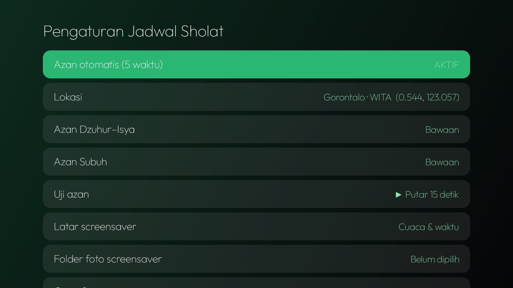

# Jadwal Sholat (`id.elkhair.sholat`)

Jadwal sholat harian, azan otomatis, dan screensaver untuk Android TV. Waktu dihitung di perangkat dengan kriteria
**Kemenag RI** (Subuh 20°, Isya 18°, Ashar Syafi'i, Dhuha 4,5°, ihtiyat 2 menit). Lokasi default Gorontalo (WITA),
bisa diganti dari Pengaturan.



## Fitur

**Layar utama**
- 8 waktu: Imsak, Subuh, Terbit, Dhuha, Dzuhur, Ashar, Maghrib, Isya — waktu berikutnya tersorot.
- Tanggal Masehi & Hijriah, lokasi, zona waktu, hitung mundur ke waktu berikutnya.
- Tekan **OK** untuk membuka Pengaturan.

**Azan otomatis (5 waktu wajib)**
- Layar azan penuh yang **tidak bisa ditutup** sampai azan selesai; Volume dan Power tetap berfungsi. Setelah itu TV
  kembali ke aplikasi sebelumnya.
- Suara azan Subuh terpisah dari Dzuhur–Isya.
- Mulai azan **tepat waktu** atau **5/10 menit sebelum** waktunya.
- Aman saat mati lampu: setiap alarm menyimpan waktu jadwalnya; alarm yang terlambat lebih dari 3 menit (mis. TV baru
  menyala) tidak membunyikan azan, dan jam yang belum tersinkron tidak dipakai.

**Pemberitahuan**
- Kartu **Imsak** dan **Dhuha** (tanpa azan) — bisa dimatikan.
- Widget **Sholat Berikutnya** di launcher eL Khair.

**Screensaver “Jam & Sholat eL Khair”** (DreamService)
- **Animasi cuaca & jam**: langit cerah, berawan, hujan, senja, malam — mengikuti cuaca nyata (Open-Meteo) atau mode uji.
- **Foto & jam**: slideshow dari folder pilihan (default `Pictures/Wallpaper`, tempat foto kiriman bot Telegram).
- Blok jam/tanggal/cuaca/sholat berikutnya bergeser tiap menit (anti burn-in).
- Pengaturan screensaver dibuka dari menu Screensaver TV, bukan dari aplikasi.

**Layar tetap menyala** selama aplikasi berjalan di depan (mis. menonton video), maksimal 4 jam. Audio di latar
belakang tidak menahan layar.

| Azan | Screensaver | Pengaturan |
|---|---|---|
|  |  |  |

## Pengaturan

| Item | Pilihan |
|---|---|
| Azan otomatis (5 waktu) | Aktif / nonaktif |
| Mulai azan | Tepat waktu · 5 menit sebelum · 10 menit sebelum |
| Pengingat Imsak & Dhuha | Aktif / nonaktif |
| Lokasi | Cari nama kota (geocoding Open-Meteo); koordinat & zona waktu ikut tersimpan |
| Azan Dzuhur–Isya · Azan Subuh | Bawaan, atau berkas audio dari penyimpanan TV |
| Uji azan | Putar 15 detik |
| *Screensaver:* Tampilan · Cuaca yang ditampilkan · Folder foto · Ganti foto setiap | Animasi cuaca/Foto · Otomatis/uji · folder · detik |

## Untuk aplikasi lain (content provider, hanya-baca)

| URI | Kolom |
|---|---|
| `content://id.elkhair.sholat.times` | `idx, name, minute, at, prayer, day, place, zone, lead, azan_on` |
| `content://id.elkhair.sholat.weather` | `temp, kind, label, night, updated, place` |

Dipakai oleh launcher eL Khair (widget, cuaca) dan Kontrol TV (mode sholat, pengingat, layar Kunci TV).

## Suara azan

Berkas azan **tidak disertakan** di repo. Pilih salah satu:

1. Taruh berkas Anda sebelum build: `app/src/main/res/raw/azan.mp3` dan (opsional) `azan_subuh.mp3`, atau
2. Setelah terpasang, pilih berkas dari penyimpanan TV di Pengaturan → Azan.

Tanpa keduanya, aplikasi memakai nada alarm sistem.

## Build & pasang

JDK 17, Android SDK platform 34.

```bash
cd jadwal-sholat
echo "sdk.dir=$HOME/Android/Sdk" > local.properties
./gradlew assembleRelease
adb install -r app/build/outputs/apk/release/app-release.apk
```

### Izin sekali lewat ADB

```bash
P=id.elkhair.sholat
adb shell appops set $P SYSTEM_ALERT_WINDOW allow                 # layar azan di atas aplikasi lain
adb shell appops set $P GET_USAGE_STATS allow                     # tahu aplikasi di depan (jaga layar)
adb shell pm grant $P android.permission.READ_EXTERNAL_STORAGE    # berkas azan & foto (Android ≤ 12)
adb shell settings put secure screensaver_components $P/$P.SholatDream   # jadikan screensaver
```

## Asal-usul & kredit

Berawal dari addon **Prayer Times** di [cleanyourtv](https://github.com/Gathin23/cleanyourtv) oleh
[@majnioui](https://github.com/majnioui) (MIT), lalu ditulis ulang: perhitungan lokal Kemenag, azan, screensaver,
provider, bahasa Indonesia. Ikon: [Lucide](https://lucide.dev) (ISC), [Feather](https://feathericons.com) (MIT).
Font: Outfit (SIL OFL, `FONT-LICENSE-OFL.txt`). Cuaca & geocoding: [Open-Meteo](https://open-meteo.com) (tanpa kunci API).
