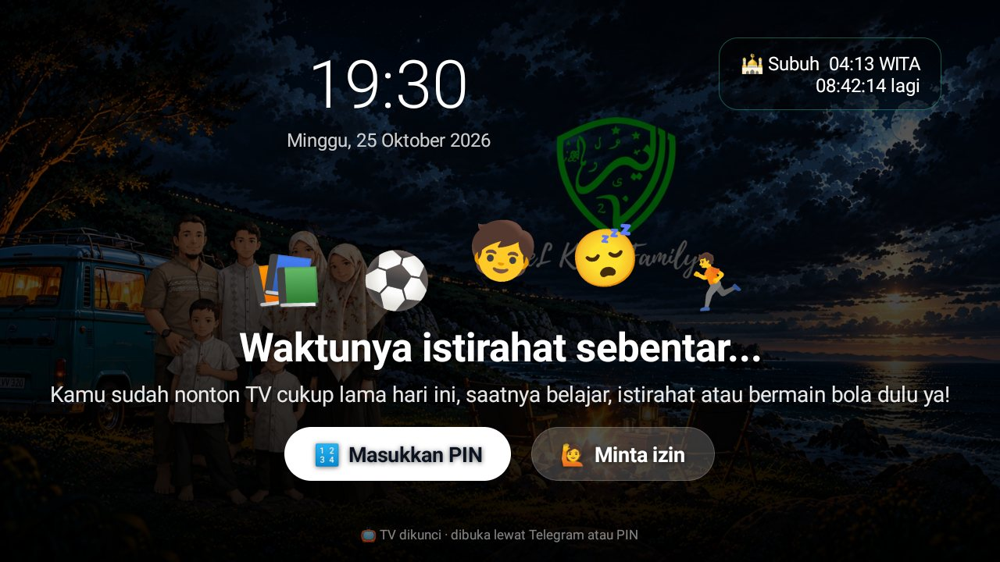
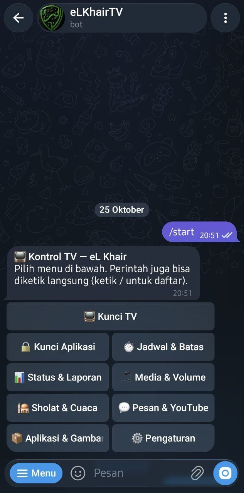
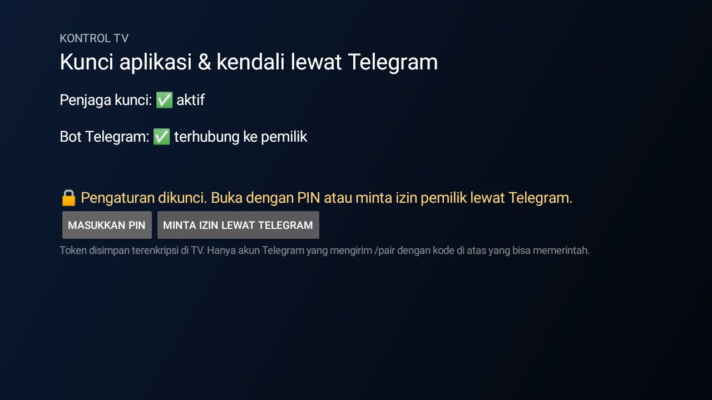

# Kontrol TV (`id.elkhair.kontroltv`)

Kendali orang tua untuk Android TV yang dioperasikan dari **bot Telegram milik Anda sendiri**: mengunci aplikasi atau
seluruh TV, jadwal & batas waktu, laporan pemakaian, pesan ke layar, remote media, background Home, dan pasang APK.
Berjalan dalam **mode aman**: tidak perlu device owner, cukup izin yang diberikan sekali lewat ADB.

| Kunci TV | Menu bot (`/start`) | Pengaturan di TV |
|---|---|---|
|  |  |  |

## Fitur

### Kunci TV
- Layar penuh di atas semua aplikasi: jam, sholat berikutnya, ikon menari, pesan default
  *“Waktunya istirahat sebentar…”* dan pesan tambahan dari Telegram (“💬 Pesan dari Ayah”). Latar = background launcher.
- Tombol **Home, Menu, Input, dan tombol pintas aplikasi** (YouTube/Netflix) diblok lewat penyaring tombol
  aksesibilitas. **Power & Volume tetap jalan**; azan dari Jadwal Sholat tetap tampil.
- Aplikasi yang sempat terbuka langsung ditutup; video yang sedang diputar dijeda.
- Dibuka dengan **PIN** (keypad milik aplikasi, bukan keyboard Android; 5× salah → 5 menit) atau dari Telegram.
- Tombol **Minta izin** → pesan ke pemilik/admin dengan tombol ✅ Buka · ⏱ 30 menit · ⏱ 1 jam · ❌ Tolak.
  Jawaban tampil di layar TV.
- Jadwal harian (`/jadwaltv 21:00-05:00`), kunci berbatas waktu (`/kuncitv 1j …`), buka sementara (`/bukatv 30`).
- Status tersimpan: tetap terkunci setelah TV dimatikan atau listrik padam.

### Kunci aplikasi & waktu
- Kunci/buka per aplikasi (`/apps` dengan tombol), buka sementara N menit.
- Jadwal kunci harian per aplikasi, batas pemakaian harian (`2j`, `90m`, `1j30m`).
- Kunci semua aplikasi hiburan, **mode sholat** (aplikasi hiburan terkunci N menit sejak waktu sholat).
- Layar blokir dengan PIN (buka 30 menit).

### Laporan & notifikasi
- `/status` (layar, aplikasi aktif, RAM, penyimpanan, IP lokal, status kunci), `/laporan` lama pemakaian hari ini,
  laporan otomatis tiap malam, `/log` 20 aktivitas terakhir.
- Notifikasi ke HP: TV menyala/standby, percobaan membuka aplikasi terkunci, PIN salah, aplikasi dibuka (opsional),
  pengingat sholat N menit sebelumnya.

### Remote dari HP
- Media (⏮ ⏯ ⏭), volume, bisu, standby, tutup aplikasi aktif.
- `/pesan teks` — kartu pesan di layar TV (30 detik).
- Kirim **link YouTube** → diputar di SmartTube.
- Kirim **foto** → masuk `Pictures/Wallpaper` (slideshow screensaver); keterangan *home* → langsung jadi background
  launcher. `/background`, `/folder` untuk memilih/menghapus.
- Kirim **file .apk** (≤ 20 MB) atau `/pasang https://…apk` → dialog pemasangan di TV; APK dihapus setelah terpasang.
  `/hapus nama` → dialog uninstall.

### Keamanan
- Disembunyikan dari launcher; layar pengaturan di TV hanya terbuka dengan PIN atau izin dari Telegram (5 menit).
- Token bot terenkripsi (Android Keystore), PIN di-hash, hanya pemilik & admin yang dilayani.
- Admin tambahan (`/admin tambah ID`) dengan **alias** yang tampil di TV (`/alias ID Ibu`; pemilik default “Ayah”).
- Pemulihan izin otomatis tiap 30 detik (aksesibilitas, akses media launcher, screensaver) dengan
  `WRITE_SECURE_SETTINGS`; `/izin` melaporkan yang belum aktif.

## Daftar perintah bot

| Perintah | Fungsi |
|---|---|
| `/start` | Menu bertombol |
| `/status` | Kondisi TV |
| `/kuncitv [1j] [pesan]` · `/bukatv [menit]` · `/jadwaltv 21:00-05:00\|hapus` | Kunci seluruh TV |
| `/apps` · `/kunci nama` · `/buka nama [menit]` · `/terkunci` · `/tutup` | Kunci aplikasi |
| `/jadwal nama 21:00-05:00` · `/batas nama 2j` | Jadwal & batas harian |
| `/kuncisemua [1j]` · `/bukasemua` · `/modesholat 15\|mati` | Kunci massal |
| `/laporan` · `/laporanotomatis 21:00\|mati` · `/log` · `/notifapp` | Laporan |
| `/pause` `/play` `/next` `/prev` · `/volume [0-100]` · `/mute` · `/standby` | Remote |
| `/pesan teks` · *link YouTube* | Ke layar TV |
| `/sholat` · `/pengingat 10\|mati` · `/cuaca` | Sholat & cuaca |
| *foto* · `/background` · `/folder` | Gambar |
| *file .apk* · `/pasang url` · `/hapus nama` | Aplikasi |
| `/pin 1234` · `/pengaturan` · `/izin` | Pengaturan |
| `/admin [tambah\|hapus ID]` · `/alias [ID] Nama` · `/lepas` | Akun (khusus pemilik) |

## Menghubungkan bot Telegram

1. Buat bot di **@BotFather** → simpan tokennya (jangan pernah di-commit).
2. Buka Kontrol TV di TV (pertama kali bebas; setelahnya perlu PIN/izin) → tempel token → **Simpan token**.
3. Layar menampilkan kode 6 digit. Dari akun Telegram Anda, kirim ke bot: `/pair KODE`.
4. Atur PIN darurat: `/pin 4821` (pesan langsung dihapus dari chat).
5. Sembunyikan dari Beranda: tambahkan `id.elkhair.kontroltv` ke `hidden_apps` di konfigurasi launcher.

## Build & pasang

```bash
cd kontrol-tv
echo "sdk.dir=$HOME/Android/Sdk" > local.properties
./gradlew assembleRelease
adb install -r app/build/outputs/apk/release/app-release.apk
```

### Izin sekali lewat ADB

```bash
P=id.elkhair.kontroltv
adb shell pm grant $P android.permission.WRITE_SECURE_SETTINGS       # pemulihan izin otomatis
adb shell appops set $P SYSTEM_ALERT_WINDOW allow                    # Kunci TV, pesan
adb shell appops set $P GET_USAGE_STATS allow                        # laporan pemakaian
adb shell appops set $P REQUEST_INSTALL_PACKAGES allow               # pasang APK dari bot
adb shell settings put secure enabled_accessibility_services $P/$P.GuardService
adb shell settings put secure accessibility_enabled 1
```

> Pada sebagian TV, memperbarui aplikasi mereset izin overlay — jalankan lagi baris `SYSTEM_ALERT_WINDOW` setelah update.

## Struktur kode

| Berkas | Isi |
|---|---|
| `GuardService` | Aksesibilitas: deteksi aplikasi, blokir, penyaring tombol saat Kunci TV |
| `TvLock` | Layar Kunci TV, PIN, minta izin, jadwal |
| `BotService` · `Bot` · `Menu` | Long-polling Telegram, perintah, menu bertombol, watchdog 30 detik |
| `Store` | Penyimpanan: kunci, jadwal, batas, PIN (hash), token (Keystore), admin, alias |
| `BlockActivity` · `SetupActivity` | Layar blokir aplikasi & layar pengaturan |
| `Extras` · `Installer` · `Apps` · `Sholat` · `Doctor` | Media/volume/foto/background, APK, daftar aplikasi, data sholat, pemeriksa izin |
