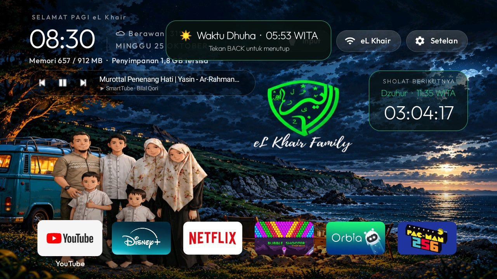
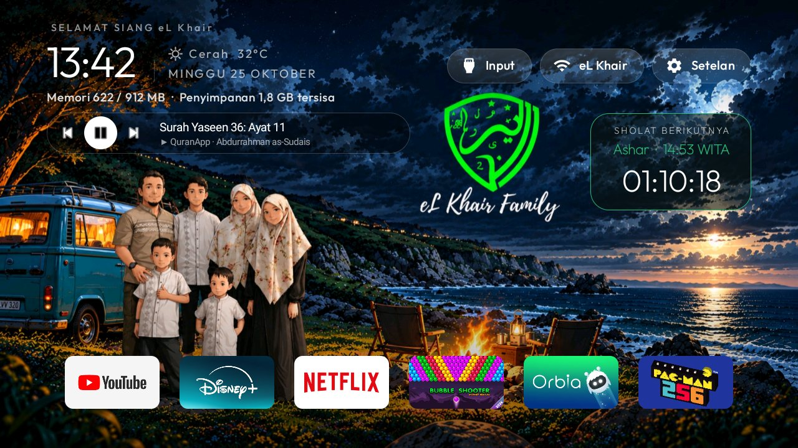
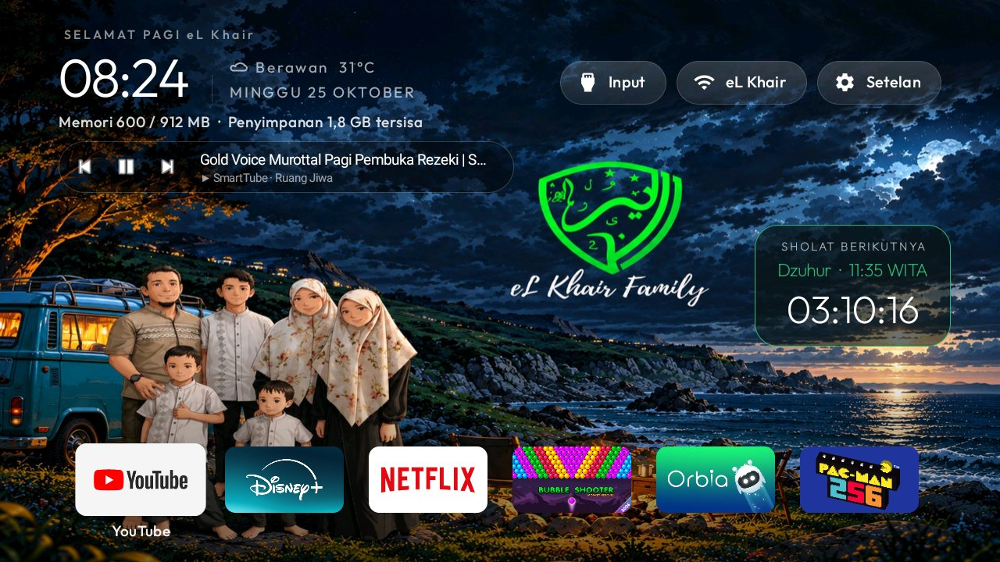

# Launcher eL Khair (`com.gathin.tvhome`)

Modifikasi launcher **[Gathin23/cleanyourtv](https://github.com/Gathin23/cleanyourtv)** (MIT) untuk TV keluarga.
Kode lengkap ada di fork: **[khairull/cleanyourtv](https://github.com/khairull/cleanyourtv)**, cabang `elkhair-tv`.
Folder ini berisi ringkasan dan patch [`elkhair-launcher.patch`](elkhair-launcher.patch) terhadap upstream
`cc4c7c5`.



## Perubahan dari upstream

| Fitur | Berkas |
|---|---|
| **Baris aplikasi horizontal** (6 tile) — opsi tema `horizontal_row` | `MainActivity`, `AppAdapter` |
| **Widget media** di bawah jam: ⏮ ⏯ ⏭, judul bisa diklik membuka pemutar; kosong bila tidak ada yang diputar atau dijeda > 3 menit | `MediaBar`, `MediaListener` |
| **Baris cuaca** di atas tanggal (dari Jadwal Sholat) | `WeatherLine` |
| **Sapaan** “SELAMAT PAGI/SIANG/MALAM eL Khair” — opsi `greeting_name` | `MainActivity`, `values-in/strings.xml` |
| Tanpa efek glow — opsi `ambient_glow`, `app_glow` | `MainActivity` |
| Muat ulang tema bila `config.json` berubah (tiap 10 detik) | `MainActivity` |

| Widget media | Cuaca & sholat |
|---|---|
|  |  |

## Konfigurasi (`/sdcard/Android/data/com.gathin.tvhome/files/config.json`)

```json
{
  "background_color": "#070A14",
  "wallpaper": true,
  "show_stats": true,
  "columns": 6,
  "dock_row": false,
  "horizontal_row": true,
  "hidden_apps": ["id.elkhair.kontroltv"],
  "greeting_name": "eL Khair",
  "ambient_glow": false,
  "app_glow": false
}
```

## Build & pasang

```bash
git clone -b elkhair-tv https://github.com/khairull/cleanyourtv
cd cleanyourtv/launcher && ./gradlew assembleRelease
adb install -r app/build/outputs/apk/release/app-release.apk
# jadikan Home bawaan
adb shell cmd package set-home-activity com.gathin.tvhome/.MainActivity
# akses sesi media untuk widget media
adb shell cmd notification allow_listener com.gathin.tvhome/com.gathin.tvhome.MediaListener
```

Atau terapkan patch ke upstream: `git apply elkhair-launcher.patch` di root clone cleanyourtv.
