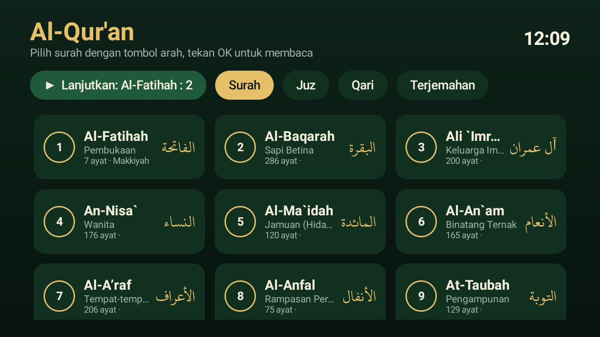
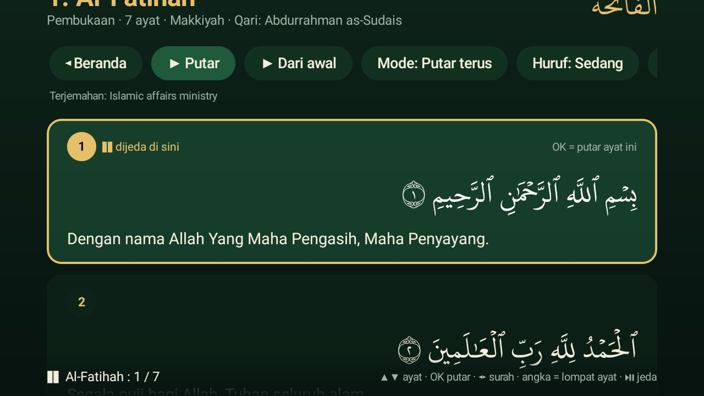
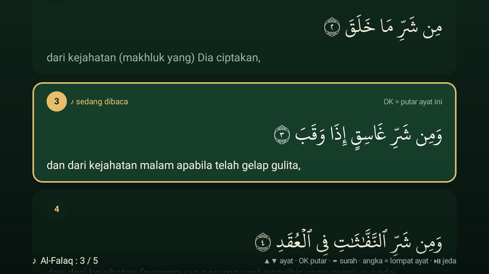

# Al-Qur'an TV — Mode TV untuk QuranApp

Tambahan **Mode TV** untuk [AlfaazPlus/QuranApp](https://github.com/AlfaazPlus/QuranApp) (GPL-3.0): layar khusus
Android TV yang nyaman dipakai dengan remote, tanpa mengubah teks Al-Qur'an.

| Beranda | Layar baca | Sedang dibaca |
|---|---|---|
|  |  |  |

## Fitur

- **Beranda**: 114 surah (nomor, nama Latin & Arab, arti, jumlah ayat, Makkiyah/Madaniyah), Juz 1–30, **Lanjutkan** ke ayat terakhir, pilih Qari & Terjemahan.
- **Layar baca**: Rasm Utsmani (font Uthmanic Hafs) dalam 4 ukuran; terjemahan **Kemenag** diunduh otomatis saat pertama dibuka (bisa disembunyikan/diganti).
- **Mengikuti bacaan**: ayat yang sedang dibaca tersorot & layar bergulir sendiri; saat audio lanjut ke surah berikutnya, layar ikut pindah.
- **Mode putar**: Putar terus · Per ayat (berhenti tiap ayat) · Ulangi tiap ayat 3×/5×/10×.
- **Setelah surah selesai**: Berhenti · Lanjut ke surah berikutnya · Ulangi surah ini terus.
- **Layar murottal**: satu ayat layar penuh, kata yang dibaca menyala emas.
- **Timer tidur** 15–90 menit; layar tidak redup selama audio berjalan.
- Integrasi launcher: klik judul di widget media membuka Mode TV tepat di ayat yang sedang dibaca; keluar dengan BACK saat audio berhenti menutup sesi media.

### Tombol remote

| Tombol | Fungsi |
|---|---|
| ▲ ▼ | pindah ayat |
| OK | putar dari ayat ini |
| ◀ ▶ · CH+/CH− | surah sebelum/sesudah |
| 0–9 | lompat ke nomor ayat |
| ⏯ ⏭ ⏮ ⏹ | jeda/lanjut, ayat berikut/sebelum, berhenti |
| MENU | menu cepat (semua pilihan juga ada sebagai tombol di bagian atas) |

## Isi folder

- [`quranapp-tv-mode.patch`](quranapp-tv-mode.patch) — semua perubahan terhadap QuranApp commit `775d424` (termasuk berkas baru).
- [`src/tv/`](src/tv/) — sumber Mode TV untuk dibaca langsung: `TvActivity.kt`, `TvViewModel.kt` (data, pemutaran, setelan), `TvScreens.kt` (Compose UI).

Perubahan pada berkas asli QuranApp:
- `AndroidManifest.xml` — `TvActivity` dengan `LEANBACK_LAUNCHER`, banner, `leanback`/`touchscreen` tidak wajib.
- `RecitationService.kt` — di TV, *session activity* membuka Mode TV pada ayat yang sedang dibaca.
- `app/build.gradle.kts` — `jvmTarget` 17; build release memakai debug key bila keystore release tidak ada.

## Build

```bash
git clone https://github.com/AlfaazPlus/QuranApp && cd QuranApp
git checkout 775d424
git apply /path/ke/elkhair-tv/quranapp-tv/quranapp-tv-mode.patch
echo "sdk.dir=$HOME/Android/Sdk" > local.properties
./gradlew assembleRelease
adb install -r app/build/outputs/apk/release/app-release.apk
```

Build release (R8) jauh lebih ringan di TV daripada debug. Bila KSP gagal diunduh, naikkan versi KSP di
`build.gradle.kts` ke rilis yang tersedia (diuji dengan `2.3.12`).

## Lisensi

GPL-3.0, sama seperti QuranApp. Teks Al-Qur'an, terjemahan, dan audio berasal dari sumber yang dipakai QuranApp.
